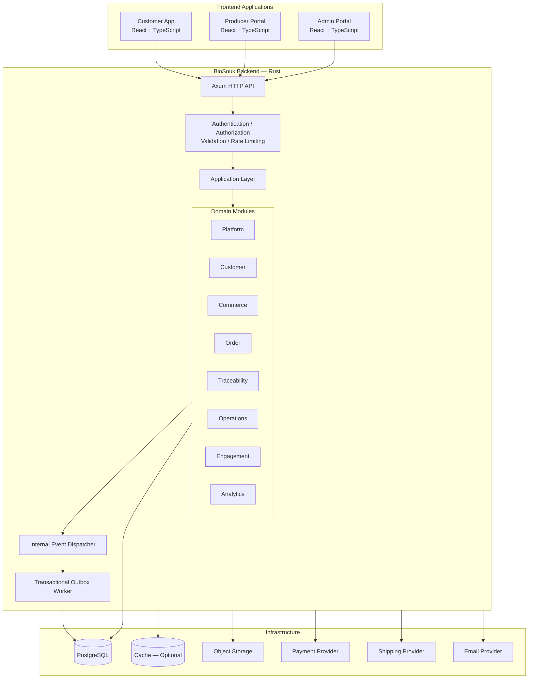
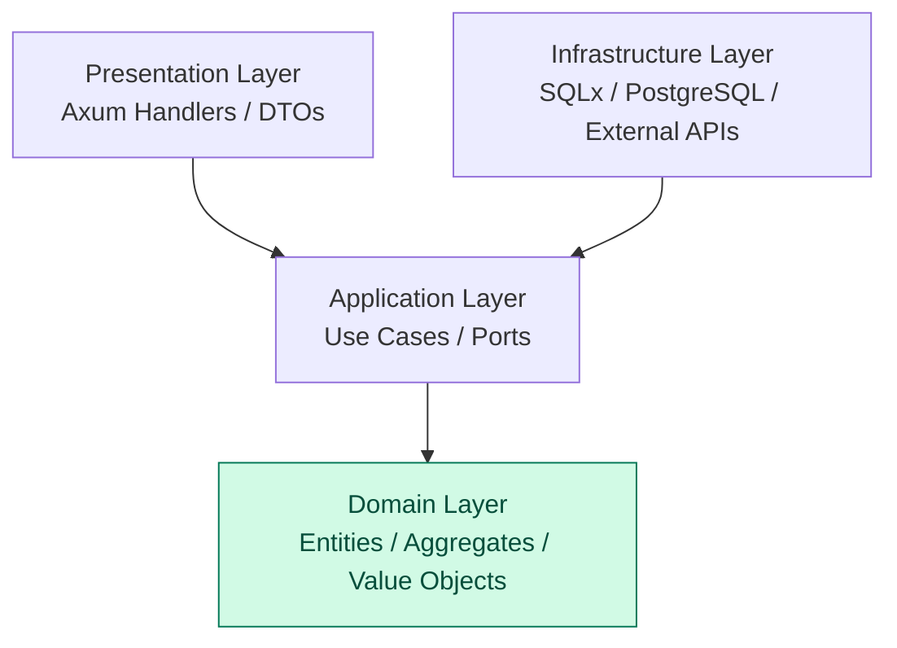
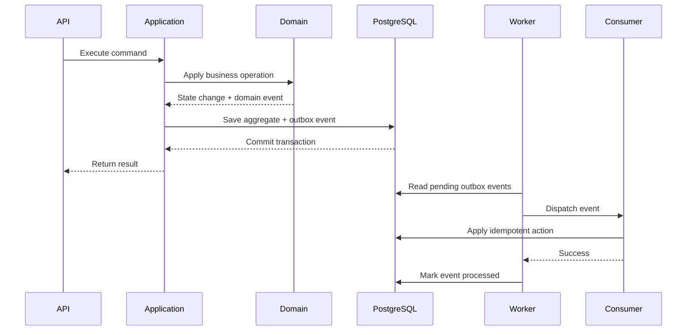
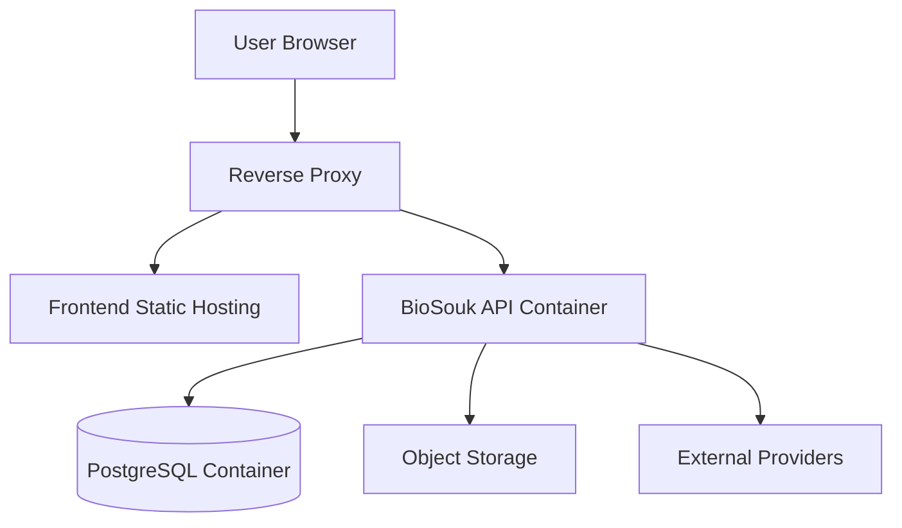

# BioSouk — System Architecture

**Document:** `03-system-architecture.md`  
**Project:** BioSouk  
**Version:** 1.0  
**Status:** Draft  
**Architecture Style:** Modular Monolith + Clean Architecture  
**Primary Language:** Rust  
**Frontend:** React + TypeScript  
**Database:** PostgreSQL

---

# 1. Purpose

This document defines the technical architecture of BioSouk.

It translates the product specification and domain model into an implementation architecture, including:

- Application structure.
- Bounded-context modules.
- Clean Architecture layers.
- Dependency rules.
- Backend and frontend responsibilities.
- Database access.
- Internal communication.
- Domain events and transactional outbox.
- Security boundaries.
- Deployment architecture.
- Testing and architectural enforcement.

The architecture must support an initial marketplace while remaining maintainable as the business grows.

# 2. Architecture Principles

The system follows these principles:

| Principle | Architectural decision |
|---|---|
| Domain independence | Business rules do not depend on frameworks |
| Modularity | Eight bounded contexts with explicit ownership |
| Simplicity | Modular monolith instead of microservices |
| Dependency inversion | Outer layers depend on inner layers |
| Data ownership | Each context owns its PostgreSQL schema |
| Explicit communication | Public application interfaces and events |
| Security | Authorization enforced by backend |
| Reliability | Transactional outbox and idempotent consumers |
| Testability | Domain logic independently testable |
| Evolvability | Modules can be extracted into services if justified |

# 3. High-Level Architecture



The backend is one deployable application.

The frontend applications communicate with it through versioned HTTP APIs.

# 4. Architecture Style: Modular Monolith

BioSouk will begin as a modular monolith.

A modular monolith means:

- One backend application.
- One deployment unit.
- One PostgreSQL database.
- Separate database schemas.
- Independently owned domain modules.
- Explicit communication contracts.
- No unrestricted cross-module database access.

## 4.1 Why a Modular Monolith?

It provides:

- Lower operational complexity.
- Simpler local development.
- Easier transactional consistency.
- Lower infrastructure cost.
- Faster initial delivery.
- Clear domain boundaries.
- A path toward future service extraction.

## 4.2 Why Not Microservices Initially?

Microservices introduce additional complexity:

- Network communication.
- Distributed transactions.
- Service discovery.
- Deployment orchestration.
- Distributed observability.
- More complicated local development.
- Operational overhead.

BioSouk does not need that complexity at the initial stage.

A module should become a separate service only when there is a measurable business or technical reason.

# 5. Clean Architecture

Every bounded context follows Clean Architecture.

The four conceptual layers are:

1. Domain
2. Application
3. Infrastructure
4. Presentation



The diagram illustrates dependency direction, not runtime request order.

## 5.1 Domain Layer

Contains:

- Entities.
- Aggregate roots.
- Value objects.
- Domain services.
- Domain events.
- Business rules.
- Domain errors.

Example:

```text
commerce/
└── domain/
    ├── product.rs
    ├── product_status.rs
    ├── money.rs
    ├── quantity.rs
    ├── product_repository.rs
    ├── events.rs
    └── errors.rs
```

Rules:

- No Axum dependency.
- No SQLx dependency.
- No PostgreSQL dependency.
- No HTTP DTO dependency.
- No external provider dependency.

## 5.2 Application Layer

Contains use cases and orchestration.

Responsibilities:

- Execute business use cases.
- Coordinate aggregates.
- Define repository and gateway ports.
- Manage transactions.
- Invoke domain services.
- Publish events through application abstractions.
- Enforce application-level authorization requirements.

Example:

```text
commerce/
└── application/
    ├── commands/
    ├── queries/
    ├── handlers/
    ├── ports/
    └── services/
```

Example use cases:

- CreateProduct
- UpdateProduct
- SubmitProductForApproval
- PublishProduct
- ChangeProductPrice
- AdjustInventory

## 5.3 Infrastructure Layer

Contains technical implementations:

- SQLx repositories.
- PostgreSQL transaction management.
- External API clients.
- Object storage clients.
- Email provider clients.
- Event outbox persistence.
- Configuration loading.

Example:

```text
commerce/
└── infrastructure/
    ├── persistence/
    │   ├── product_repository.rs
    │   └── inventory_repository.rs
    └── external/
```

Infrastructure implements interfaces defined by the application or domain.

## 5.4 Presentation Layer

Contains:

- Axum routes.
- HTTP handlers.
- Request DTOs.
- Response DTOs.
- Authentication extractors.
- Input validation.
- HTTP error mapping.

Example:

```text
commerce/
└── presentation/
    ├── routes.rs
    ├── handlers/
    ├── requests.rs
    └── responses.rs
```

Presentation must not contain business rules.

# 6. Backend Workspace Structure

Use a single Rust workspace initially.

```text
biosouk/
│
├── Cargo.toml
├── Cargo.lock
├── rust-toolchain.toml
├── constitution.md
│
├── backend/
│   ├── Cargo.toml
│   │
│   ├── crates/
│   │   ├── biosouk-api/
│   │   │   ├── Cargo.toml
│   │   │   └── src/
│   │   │       ├── main.rs
│   │   │       ├── app.rs
│   │   │       ├── config.rs
│   │   │       ├── state.rs
│   │   │       └── routes.rs
│   │   │
│   │   ├── biosouk-shared/
│   │   │   ├── Cargo.toml
│   │   │   └── src/
│   │   │       ├── lib.rs
│   │   │       ├── ids.rs
│   │   │       ├── money.rs
│   │   │       ├── errors.rs
│   │   │       └── pagination.rs
│   │   │
│   │   ├── biosouk-platform/
│   │   ├── biosouk-customer/
│   │   ├── biosouk-commerce/
│   │   ├── biosouk-order/
│   │   ├── biosouk-traceability/
│   │   ├── biosouk-operations/
│   │   ├── biosouk-engagement/
│   │   └── biosouk-analytics/
│   │
│   └── migrations/
│
├── frontend/
│   ├── customer-app/
│   ├── producer-portal/
│   └── admin-portal/
│
├── tools/
│   └── synthetic-data-generator/
│
├── database/
│
├── tests/
│
├── docs/
│
├── docker-compose.yml
└── README.md
```

Each domain crate should have a structure similar to:

```text
biosouk-commerce/
└── src/
    ├── lib.rs
    ├── domain/
    │   ├── mod.rs
    │   ├── product/
    │   ├── inventory/
    │   └── events.rs
    ├── application/
    │   ├── mod.rs
    │   ├── commands/
    │   ├── queries/
    │   ├── handlers/
    │   └── ports/
    ├── infrastructure/
    │   ├── mod.rs
    │   ├── persistence/
    │   └── external/
    └── presentation/
        ├── mod.rs
        ├── routes.rs
        └── handlers/
```

The exact internal structure can evolve as each module grows. Avoid creating empty abstractions without a concrete use case.

# 7. Rust Crate Responsibilities

| Crate | Responsibility |
|---|---|
| biosouk-api | Application bootstrap and HTTP composition |
| biosouk-shared | Small shared technical primitives |
| biosouk-platform | Identity, authentication and authorization |
| biosouk-customer | Customer profiles and preferences |
| biosouk-commerce | Catalog, pricing and inventory |
| biosouk-order | Cart, orders, payments, shipments and returns |
| biosouk-traceability | Producers, farms, batches and certifications |
| biosouk-operations | Warehouses, procurement and fulfillment |
| biosouk-engagement | Reviews and discovery |
| biosouk-analytics | Read-only analytical models |

A domain crate must expose only the public types and interfaces other crates need.

Avoid exposing internal repository implementations.

# 8. Dependency Architecture

## 8.1 Allowed Dependencies

The API crate can compose all domain modules.

Domain modules may use the shared crate for stable, generic primitives.

Application layers may depend on domain layers.

Infrastructure layers implement application-defined ports.

Presentation layers invoke application use cases.

## 8.2 Forbidden Dependencies

The following are prohibited:

- Domain → Axum.
- Domain → SQLx.
- Domain → PostgreSQL driver.
- Domain → external payment SDK.
- Domain → another domain's private repository.
- One domain's infrastructure → another domain's infrastructure.
- Analytics → transactional write interfaces.

## 8.3 Dependency Matrix

| Module | May use |
|---|---|
| Platform | Shared |
| Customer | Shared, Platform public contracts |
| Commerce | Shared, Traceability public contracts |
| Order | Shared, Customer and Commerce public contracts |
| Traceability | Shared, Platform public contracts |
| Operations | Shared, Order and Traceability public contracts |
| Engagement | Shared, Customer and Commerce public contracts |
| Analytics | Shared and published domain events |
| API | All domain public interfaces |

These are logical dependencies. They must not become unrestricted direct database dependencies.

# 9. Domain Communication

There are two primary communication mechanisms.

## 9.1 Synchronous Communication

Use application interfaces when an operation needs an immediate result.

Example:

Product publication requires checking producer verification and applicable certification status.

Commerce can call a Traceability application interface:

```text
Commerce Application
        |
        v
Traceability Public Interface
        |
        v
Traceability Application
        |
        v
Traceability Repository Port
```

The Commerce module does not access Traceability tables directly.

## 9.2 Asynchronous Communication

Use domain events when another context needs to react to a completed business fact.

Example:

```text
Order Confirmed
       |
       v
Order Event
       |
       v
Operations Consumer
       |
       v
Fulfillment Created
```

Event consumers must be idempotent.

# 10. Application Bootstrap

The `biosouk-api` crate is the composition root.

Its responsibilities:

1. Load configuration.
2. Initialize tracing and logging.
3. Establish database connections.
4. Initialize infrastructure implementations.
5. Construct repositories.
6. Construct application services.
7. Register event handlers.
8. Start background workers.
9. Configure middleware.
10. Register HTTP routes.
11. Start the Axum server.

Conceptual startup:

```rust
#[tokio::main]
async fn main() -> anyhow::Result<()> {
    let config = AppConfig::load()?;

    let pool = create_database_pool(&config.database).await?;

    let state = build_application_state(config, pool).await?;

    let app = build_router(state);

    start_server(app).await?;

    Ok(())
}
```

This is an architectural illustration, not the complete production implementation.

Dependency construction should happen in the composition root rather than inside domain modules.

# 11. API Architecture

Use REST APIs for the initial application.

Recommended route organization:

```text
/api/v1/
│
├── auth/
├── users/
├── customers/
├── producers/
├── farms/
├── products/
├── categories/
├── certifications/
├── batches/
├── inventory/
├── carts/
├── orders/
├── payments/
├── shipments/
├── returns/
├── refunds/
├── reviews/
├── admin/
└── analytics/
```

## API Rules

- Version APIs explicitly.
- Validate requests at the boundary.
- Use request and response DTOs.
- Never expose database models directly.
- Return consistent error structures.
- Use pagination for collection endpoints.
- Apply authorization to every protected operation.
- Use idempotency keys for operations where duplicate execution could cause financial or inventory effects.

# 12. Database Architecture

Use PostgreSQL with separate schemas for each bounded context.

```text
biosouk_db
│
├── platform
├── customer
├── commerce
├── order
├── traceability
├── operations
├── engagement
└── analytics
```

## Database Rules

1. Each context owns its tables.
2. A context cannot write directly to another context's tables.
3. Cross-context relationships use stable identifiers.
4. Foreign keys may be used where appropriate, but must not undermine ownership boundaries.
5. Cross-context workflows use application interfaces and events.
6. Schema migrations must be version-controlled.
7. Use SQLx transactions for aggregate persistence.
8. Use an outbox table for reliable event publication.

The exact table definitions, indexes, constraints, and migration strategy belong in `05-database-design.md`.

# 13. Event Architecture

Use an internal event dispatcher initially.

The event architecture contains:

- Domain event definitions.
- Event handlers.
- Outbox persistence.
- Background event publisher.
- Idempotent consumers.
- Retry and failure handling.



Aggregate persistence and outbox insertion must occur in the same database transaction.

A failed consumer must not silently lose an event.

# 14. External Integration Architecture

External services must be accessed through application-defined ports and infrastructure adapters.

| Integration | Purpose | Boundary |
|---|---|---|
| Payment provider | Payment and refunds | Payment gateway |
| Shipping provider | Labels and tracking | Shipping gateway |
| Email provider | Transactional email | Notification gateway |
| Object storage | Product and certification files | Storage gateway |

Rules:

- Never call external APIs directly from domain entities.
- Use timeouts.
- Retry only operations safe to retry.
- Use idempotency keys where supported.
- Store external references.
- Validate webhook signatures.
- Record integration failures.
- Keep provider-specific DTOs inside infrastructure.

Provider selection is intentionally unresolved until the integration architecture document.

# 15. Frontend Architecture

BioSouk has three frontend applications.

## 15.1 Customer Application

Responsibilities:

- Registration and login.
- Product discovery.
- Product details.
- Traceability information.
- Shopping cart.
- Checkout.
- Orders and returns.
- Reviews and customer profile.

## 15.2 Producer Portal

Responsibilities:

- Producer profile.
- Farm management.
- Product management.
- Batch creation.
- Certification submission.
- Inventory visibility.
- Order fulfillment.
- Sales reporting.

## 15.3 Admin Portal

Responsibilities:

- User and role administration.
- Producer verification.
- Product approval.
- Certification review.
- Recall management.
- Order support.
- Refund oversight.
- Operational dashboards.

## 15.4 Frontend Technology

- React.
- TypeScript.
- Vite.
- React Router.
- A typed API client.
- A server-state management solution.
- Form validation.
- Component-based UI architecture.

Frontend applications must not implement authoritative business rules.

The backend remains responsible for authorization, pricing, inventory, order transitions, and certification validation.

# 16. Security Architecture

Security is cross-cutting.

Core controls:

- JWT access tokens.
- Refresh-token rotation and revocation.
- Argon2id password hashing.
- Role-based access control.
- Backend authorization.
- Request validation.
- Rate limiting.
- Secure file uploads.
- Audit logging.
- Secret management.
- Dependency vulnerability scanning.

Roles:

- Admin
- Producer
- Customer
- Support

Authorization must be based on both role and resource ownership where appropriate.

For example, a producer may update only products and batches they are authorized to manage.

Detailed policies belong in `07-security-architecture.md`.

# 17. Background Processing

Background workers handle work that should not block HTTP requests.

Initial responsibilities:

- Outbox event dispatch.
- Email delivery.
- Payment reconciliation.
- Certification expiration checks.
- Shipment tracking updates.
- Inventory consistency checks.

Use Tokio tasks and controlled worker loops initially.

Each worker must define:

- Execution interval or trigger.
- Batch size.
- Retry policy.
- Timeout.
- Idempotency behavior.
- Error handling.
- Observability.

Do not introduce a separate message broker until operational requirements justify it.

# 18. Observability

The backend must support:

- Structured logging.
- Distributed trace context.
- Request correlation IDs.
- Metrics.
- Health checks.
- Readiness checks.
- Background-worker monitoring.
- Error reporting.

Important initial metrics:

- HTTP request rate.
- HTTP error rate.
- Request latency.
- Database connection utilization.
- Query latency.
- Outbox backlog.
- Event processing failures.
- Payment failures.
- Inventory reservation failures.
- Background worker failures.

Detailed observability standards belong in `13-observability-and-operations.md`.

# 19. Deployment Architecture

Initial deployment uses Docker.



Development can use Docker Compose with:

- PostgreSQL.
- Backend.
- Frontend applications.
- Optional local object storage.

Production topology, secrets, backup, recovery, and CI/CD policies are defined in the deployment document.

# 20. Testing Architecture

Testing follows architectural boundaries.

| Test type | Target |
|---|---|
| Unit | Domain entities, value objects and rules |
| Application | Use cases and orchestration |
| Repository integration | SQLx and PostgreSQL |
| API integration | Axum endpoints |
| Contract | Module and external integration contracts |
| Architecture | Dependency and ownership rules |
| Frontend | Components and user workflows |
| E2E | Complete marketplace journeys |
| Performance | Critical APIs and database operations |
| Security | Authentication, authorization and abuse cases |

Domain tests should not require a running database.

# 21. Architecture Decision Records

Important architectural changes require ADRs.

Initial ADR candidates:

- ADR-001: Modular Monolith.
- ADR-002: Clean Architecture.
- ADR-003: Rust Backend.
- ADR-004: PostgreSQL Schema-per-Context.
- ADR-005: Transactional Outbox.
- ADR-006: REST API.
- ADR-007: React Frontend Applications.
- ADR-008: Internal Event Dispatcher.

ADRs must document context, decision, alternatives, trade-offs, and consequences.

# 22. Architecture Constraints

The following constraints are mandatory:

1. No business logic in Axum handlers.
2. No SQLx dependency in domain modules.
3. No cross-context private repository access.
4. No direct cross-context table writes.
5. No frontend-only authorization.
6. No plaintext credentials.
7. No external API calls from domain entities.
8. No uncontrolled background tasks.
9. No event publication without reliable persistence.
10. No introduction of microservices without an ADR.

# 23. Implementation Readiness Criteria

The architecture is ready for implementation when:

- [ ] Rust workspace structure is established.
- [ ] Eight domain crates are defined.
- [ ] Clean Architecture boundaries are documented.
- [ ] Dependency rules are agreed.
- [ ] Application composition root is defined.
- [ ] Database ownership is established.
- [ ] Cross-domain communication contracts are understood.
- [ ] Event and outbox strategy is established.
- [ ] Frontend application boundaries are established.
- [ ] Security architecture is understood.
- [ ] Testing boundaries are documented.
- [ ] ADR process is established.

---

# Final Architecture Principle

BioSouk is a domain-oriented modular monolith.

Its architecture must make business ownership explicit, preserve Clean Architecture dependency rules, protect transactional integrity, and keep traceability auditable.

The implementation should remain simple until measurable requirements justify additional infrastructure or distributed architecture.
