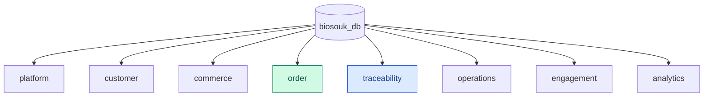

# BioSouk — Database Design

**Document:** `05-database-design.md`  
**Project:** BioSouk  
**Version:** 1.0  
**Status:** Draft  
**Database:** PostgreSQL  
**Data Access:** SQLx  
**Architecture:** Schema-per-Bounded-Context

**Governing Documents:**
- `constitution.md`
- `docs/01-product-specification.md`
- `docs/02-domain-model.md`
- `docs/03-system-architecture.md`
- `docs/04-domain-workflows.md`

---

# 1. Purpose

This document defines the logical and physical database design for BioSouk.

It covers:

- PostgreSQL database organization.
- Schema ownership.
- Table definitions and responsibilities.
- Primary and foreign keys.
- Relationships and constraints.
- Indexing strategy.
- Inventory and reservation consistency.
- Order and payment persistence.
- Product traceability and historical records.
- Transactional outbox.
- Migration management.
- Data integrity and retention.

The database must reflect the domain model without becoming the source of business logic.

# 2. Database Architecture

BioSouk uses one PostgreSQL database with separate schemas for each bounded context.

Database name:

`biosouk_db`

Schemas:

| Schema | Owner | Responsibility |
|---|---|---|
| platform | Platform | Users, roles, permissions, sessions, audit |
| customer | Customer | Customer profiles, addresses, consent, loyalty |
| commerce | Commerce | Products, categories, prices, promotions, inventory |
| order | Order | Carts, orders, payments, shipments, returns, refunds |
| traceability | Traceability | Producers, farms, origins, batches, certifications, recalls |
| operations | Operations | Warehouses, suppliers, procurement, fulfillment |
| engagement | Engagement | Reviews, campaigns, recommendations, interactions |
| analytics | Analytics | Read-only analytical projections |

Infrastructure-owned tables may be placed in a separate `infrastructure` schema if needed. They must not be treated as another business bounded context.

## 2.1 Database Overview



# 3. Database Standards

## 3.1 Naming Conventions

Use:

- `snake_case` for schemas, tables, columns, indexes, and constraints.
- Singular or consistently plural table names; this design uses plural names.
- Explicit primary key names such as `id`.
- Foreign keys named `<referenced_entity>_id`.
- Indexes named `idx_<table>_<columns>`.
- Unique constraints named `uq_<table>_<columns>`.
- Check constraints named `ck_<table>_<rule>`.

Examples:

- `platform.users`
- `commerce.products`
- `traceability.batches`
- `order.order_items`
- `idx_products_status_category_id`

## 3.2 Primary Keys

Use UUID primary keys.

Example:

```sql
id UUID PRIMARY KEY DEFAULT gen_random_uuid()
```

Application-generated UUIDs are also acceptable.

Use a consistent ID-generation strategy across the application. UUIDv7 may be adopted if time-ordered identifiers are desired and the chosen Rust and PostgreSQL implementation is consistent.

## 3.3 Timestamps

Use `TIMESTAMPTZ` for timestamps representing real-world instants.

Standard fields:

- `created_at`
- `updated_at`

Use UTC for persistence and explicit time-zone conversion for presentation.

Example:

```sql
created_at TIMESTAMPTZ NOT NULL DEFAULT NOW(),
updated_at TIMESTAMPTZ NOT NULL DEFAULT NOW()
```

Do not assume a database default automatically updates `updated_at`; application logic or an explicitly designed database trigger must handle updates.

## 3.4 Monetary Values

Never use floating-point types for financial amounts.

Use:

```sql
NUMERIC(19, 4)
```

Store currency separately:

```sql
currency CHAR(3) NOT NULL
```

The application must validate currency codes and decimal precision according to the currency's rules.

## 3.5 Quantities

Use `NUMERIC` for weight, volume, and fractional quantities.

Use explicit units:

- kg
- g
- L
- ml
- unit

The allowed unit vocabulary must be controlled by the application.

## 3.6 Boolean and Status Fields

Use explicit boolean values for independent flags.

Use constrained text or PostgreSQL enum types for lifecycle statuses. Prefer constrained text with application-level domain types when status evolution needs flexible migrations.

## 3.7 Auditability

Important business records should include:

- `created_at`
- `updated_at`
- `created_by`
- `updated_by`

Not every table requires every field. Financial, security, certification, inventory, and recall operations require stronger audit records.

# 4. Platform Schema

## 4.1 Tables

| Table | Purpose |
|---|---|
| users | Platform identities |
| roles | Authorization roles |
| permissions | Individual permissions |
| user_roles | User-role assignments |
| role_permissions | Role-permission assignments |
| refresh_tokens | Refresh-token sessions |
| audit_logs | Security and administrative audit records |

## 4.2 users

```sql
CREATE TABLE platform.users (
    id UUID PRIMARY KEY DEFAULT gen_random_uuid(),
    email VARCHAR(320) NOT NULL,
    password_hash TEXT NOT NULL,
    status VARCHAR(30) NOT NULL,
    email_verified_at TIMESTAMPTZ,
    created_at TIMESTAMPTZ NOT NULL DEFAULT NOW(),
    updated_at TIMESTAMPTZ NOT NULL DEFAULT NOW(),

    CONSTRAINT uq_users_email UNIQUE (email),
    CONSTRAINT ck_users_status
        CHECK (status IN ('pending', 'active', 'suspended', 'closed'))
);
```

Email normalization and case-insensitive uniqueness must be enforced consistently. A suitable implementation is a normalized email column or a unique index on `lower(email)`.

## 4.3 roles

```sql
CREATE TABLE platform.roles (
    id UUID PRIMARY KEY DEFAULT gen_random_uuid(),
    code VARCHAR(50) NOT NULL UNIQUE,
    name VARCHAR(100) NOT NULL,
    description TEXT,
    created_at TIMESTAMPTZ NOT NULL DEFAULT NOW()
);
```

## 4.4 permissions

```sql
CREATE TABLE platform.permissions (
    id UUID PRIMARY KEY DEFAULT gen_random_uuid(),
    code VARCHAR(100) NOT NULL UNIQUE,
    description TEXT
);
```

## 4.5 user_roles

```sql
CREATE TABLE platform.user_roles (
    user_id UUID NOT NULL REFERENCES platform.users(id),
    role_id UUID NOT NULL REFERENCES platform.roles(id),
    assigned_at TIMESTAMPTZ NOT NULL DEFAULT NOW(),
    assigned_by UUID,
    PRIMARY KEY (user_id, role_id)
);
```

## 4.6 role_permissions

```sql
CREATE TABLE platform.role_permissions (
    role_id UUID NOT NULL REFERENCES platform.roles(id),
    permission_id UUID NOT NULL REFERENCES platform.permissions(id),
    PRIMARY KEY (role_id, permission_id)
);
```

## 4.7 refresh_tokens

```sql
CREATE TABLE platform.refresh_tokens (
    id UUID PRIMARY KEY DEFAULT gen_random_uuid(),
    user_id UUID NOT NULL REFERENCES platform.users(id),
    token_hash TEXT NOT NULL UNIQUE,
    expires_at TIMESTAMPTZ NOT NULL,
    revoked_at TIMESTAMPTZ,
    created_at TIMESTAMPTZ NOT NULL DEFAULT NOW()
);
```

Store only token hashes, not raw refresh tokens.

## 4.8 audit_logs

```sql
CREATE TABLE platform.audit_logs (
    id UUID PRIMARY KEY DEFAULT gen_random_uuid(),
    actor_id UUID,
    action VARCHAR(100) NOT NULL,
    resource_type VARCHAR(100) NOT NULL,
    resource_id UUID,
    metadata JSONB NOT NULL DEFAULT '{}',
    correlation_id UUID,
    created_at TIMESTAMPTZ NOT NULL DEFAULT NOW()
);
```

Audit records should be append-only to application roles. Avoid storing passwords, access tokens, refresh tokens, or other secrets in metadata.

# 5. Customer Schema

## 5.1 Tables

| Table | Purpose |
|---|---|
| customers | Customer profiles |
| addresses | Customer addresses |
| customer_preferences | Customer preferences |
| consents | Consent records |
| loyalty_accounts | Loyalty account balances |
| loyalty_transactions | Loyalty point movements |

## 5.2 customers

```sql
CREATE TABLE customer.customers (
    id UUID PRIMARY KEY DEFAULT gen_random_uuid(),
    user_id UUID NOT NULL UNIQUE,
    first_name VARCHAR(100) NOT NULL,
    last_name VARCHAR(100) NOT NULL,
    phone VARCHAR(30),
    status VARCHAR(30) NOT NULL DEFAULT 'active',
    created_at TIMESTAMPTZ NOT NULL DEFAULT NOW(),
    updated_at TIMESTAMPTZ NOT NULL DEFAULT NOW()
);
```

`user_id` references the Platform identity through an explicit application-level relationship. It is not a cross-context write permission.

## 5.3 addresses

```sql
CREATE TABLE customer.addresses (
    id UUID PRIMARY KEY DEFAULT gen_random_uuid(),
    customer_id UUID NOT NULL REFERENCES customer.customers(id),
    address_line1 VARCHAR(255) NOT NULL,
    address_line2 VARCHAR(255),
    city VARCHAR(100) NOT NULL,
    region VARCHAR(100),
    postal_code VARCHAR(30),
    country_code CHAR(2) NOT NULL,
    is_default BOOLEAN NOT NULL DEFAULT FALSE,
    created_at TIMESTAMPTZ NOT NULL DEFAULT NOW(),
    updated_at TIMESTAMPTZ NOT NULL DEFAULT NOW()
);
```

Only one default address per customer:

```sql
CREATE UNIQUE INDEX uq_addresses_default_per_customer
ON customer.addresses(customer_id)
WHERE is_default = TRUE;
```

Changing the default address must be performed transactionally.

## 5.4 customer_preferences

```sql
CREATE TABLE customer.customer_preferences (
    id UUID PRIMARY KEY DEFAULT gen_random_uuid(),
    customer_id UUID NOT NULL REFERENCES customer.customers(id),
    preference_type VARCHAR(80) NOT NULL,
    preference_value JSONB NOT NULL,
    updated_at TIMESTAMPTZ NOT NULL DEFAULT NOW(),

    CONSTRAINT uq_customer_preference
        UNIQUE (customer_id, preference_type)
);
```

## 5.5 consents

```sql
CREATE TABLE customer.consents (
    id UUID PRIMARY KEY DEFAULT gen_random_uuid(),
    customer_id UUID NOT NULL REFERENCES customer.customers(id),
    consent_type VARCHAR(80) NOT NULL,
    granted BOOLEAN NOT NULL,
    granted_at TIMESTAMPTZ,
    withdrawn_at TIMESTAMPTZ,
    created_at TIMESTAMPTZ NOT NULL DEFAULT NOW()
);
```

Consent history must be retained according to applicable privacy and retention requirements. Do not overwrite historical consent decisions.

## 5.6 loyalty_accounts

```sql
CREATE TABLE customer.loyalty_accounts (
    id UUID PRIMARY KEY DEFAULT gen_random_uuid(),
    customer_id UUID NOT NULL UNIQUE REFERENCES customer.customers(id),
    points_balance BIGINT NOT NULL DEFAULT 0,
    status VARCHAR(30) NOT NULL DEFAULT 'active',
    created_at TIMESTAMPTZ NOT NULL DEFAULT NOW(),
    updated_at TIMESTAMPTZ NOT NULL DEFAULT NOW(),

    CONSTRAINT ck_loyalty_balance
        CHECK (points_balance >= 0)
);
```

## 5.7 loyalty_transactions

```sql
CREATE TABLE customer.loyalty_transactions (
    id UUID PRIMARY KEY DEFAULT gen_random_uuid(),
    loyalty_account_id UUID NOT NULL
        REFERENCES customer.loyalty_accounts(id),
    transaction_type VARCHAR(30) NOT NULL,
    points BIGINT NOT NULL,
    reference_type VARCHAR(80),
    reference_id UUID,
    idempotency_key VARCHAR(150) UNIQUE,
    created_at TIMESTAMPTZ NOT NULL DEFAULT NOW(),

    CONSTRAINT ck_loyalty_points
        CHECK (points > 0)
);
```

The account balance and ledger transaction must be updated in one transaction.

# 6. Commerce Schema

## 6.1 Tables

| Table | Purpose |
|---|---|
| categories | Product categories |
| brands | Product brands |
| products | Product catalog |
| product_images | Product media references |
| product_prices | Product pricing history |
| promotions | Promotions |
| promotion_products | Product-promotion association |
| inventory_items | Stock by product, batch and location |
| inventory_reservations | Stock reservation records |
| inventory_movements | Inventory ledger |

## 6.2 categories

```sql
CREATE TABLE commerce.categories (
    id UUID PRIMARY KEY DEFAULT gen_random_uuid(),
    parent_category_id UUID REFERENCES commerce.categories(id),
    name VARCHAR(150) NOT NULL,
    slug VARCHAR(180) NOT NULL UNIQUE,
    description TEXT,
    status VARCHAR(30) NOT NULL DEFAULT 'active',
    created_at TIMESTAMPTZ NOT NULL DEFAULT NOW(),
    updated_at TIMESTAMPTZ NOT NULL DEFAULT NOW()
);
```

## 6.3 brands

```sql
CREATE TABLE commerce.brands (
    id UUID PRIMARY KEY DEFAULT gen_random_uuid(),
    name VARCHAR(150) NOT NULL,
    description TEXT,
    status VARCHAR(30) NOT NULL DEFAULT 'active',
    created_at TIMESTAMPTZ NOT NULL DEFAULT NOW()
);
```

## 6.4 products

```sql
CREATE TABLE commerce.products (
    id UUID PRIMARY KEY DEFAULT gen_random_uuid(),
    producer_id UUID NOT NULL,
    category_id UUID NOT NULL REFERENCES commerce.categories(id),
    brand_id UUID REFERENCES commerce.brands(id),
    name VARCHAR(200) NOT NULL,
    slug VARCHAR(220) NOT NULL UNIQUE,
    description TEXT NOT NULL,
    product_type VARCHAR(80) NOT NULL,
    pricing_model VARCHAR(40) NOT NULL,
    unit_of_measure VARCHAR(30) NOT NULL,
    traceability_required BOOLEAN NOT NULL DEFAULT TRUE,
    status VARCHAR(30) NOT NULL DEFAULT 'draft',
    created_at TIMESTAMPTZ NOT NULL DEFAULT NOW(),
    updated_at TIMESTAMPTZ NOT NULL DEFAULT NOW()
);
```

`producer_id` is a reference to the Traceability context. Commerce must not own or update the producer record.

Product publication requires application-level validation of producer status, required certifications, and traceability conditions.

## 6.5 product_images

```sql
CREATE TABLE commerce.product_images (
    id UUID PRIMARY KEY DEFAULT gen_random_uuid(),
    product_id UUID NOT NULL REFERENCES commerce.products(id),
    storage_key TEXT NOT NULL,
    alt_text VARCHAR(255),
    display_order INTEGER NOT NULL DEFAULT 0,
    created_at TIMESTAMPTZ NOT NULL DEFAULT NOW()
);
```

Store object-storage keys rather than large image binaries in the product table.

## 6.6 product_prices

```sql
CREATE TABLE commerce.product_prices (
    id UUID PRIMARY KEY DEFAULT gen_random_uuid(),
    product_id UUID NOT NULL REFERENCES commerce.products(id),
    amount NUMERIC(19, 4) NOT NULL,
    currency CHAR(3) NOT NULL,
    effective_from TIMESTAMPTZ NOT NULL,
    effective_to TIMESTAMPTZ,
    created_at TIMESTAMPTZ NOT NULL DEFAULT NOW(),

    CONSTRAINT ck_product_price_positive CHECK (amount > 0),
    CONSTRAINT ck_product_price_dates
        CHECK (effective_to IS NULL OR effective_to > effective_from)
);
```

Use an explicit rule to prevent overlapping active price periods for the same product and currency. A PostgreSQL exclusion constraint or transactional application validation can enforce the selected policy.

## 6.7 promotions

```sql
CREATE TABLE commerce.promotions (
    id UUID PRIMARY KEY DEFAULT gen_random_uuid(),
    name VARCHAR(150) NOT NULL,
    promotion_type VARCHAR(40) NOT NULL,
    discount_value NUMERIC(19, 4) NOT NULL,
    starts_at TIMESTAMPTZ NOT NULL,
    ends_at TIMESTAMPTZ NOT NULL,
    status VARCHAR(30) NOT NULL,
    created_at TIMESTAMPTZ NOT NULL DEFAULT NOW(),

    CONSTRAINT ck_promotion_dates CHECK (ends_at > starts_at),
    CONSTRAINT ck_promotion_discount CHECK (discount_value > 0)
);
```

## 6.8 promotion_products

```sql
CREATE TABLE commerce.promotion_products (
    promotion_id UUID NOT NULL REFERENCES commerce.promotions(id),
    product_id UUID NOT NULL REFERENCES commerce.products(id),
    PRIMARY KEY (promotion_id, product_id)
);
```

## 6.9 inventory_items

Inventory is tracked by product, batch, and location.

```sql
CREATE TABLE commerce.inventory_items (
    id UUID PRIMARY KEY DEFAULT gen_random_uuid(),
    product_id UUID NOT NULL REFERENCES commerce.products(id),
    batch_id UUID NOT NULL,
    location_id UUID NOT NULL,
    quantity_on_hand NUMERIC(19, 4) NOT NULL DEFAULT 0,
    quantity_reserved NUMERIC(19, 4) NOT NULL DEFAULT 0,
    unit_of_measure VARCHAR(30) NOT NULL,
    updated_at TIMESTAMPTZ NOT NULL DEFAULT NOW(),

    CONSTRAINT uq_inventory_product_batch_location
        UNIQUE (product_id, batch_id, location_id),

    CONSTRAINT ck_inventory_on_hand
        CHECK (quantity_on_hand >= 0),

    CONSTRAINT ck_inventory_reserved
        CHECK (
            quantity_reserved >= 0
            AND quantity_reserved <= quantity_on_hand
        )
);
```

`batch_id` belongs to Traceability and `location_id` belongs to Operations. They are external domain references, not permission to write to those contexts.

## 6.10 inventory_reservations

```sql
CREATE TABLE commerce.inventory_reservations (
    id UUID PRIMARY KEY DEFAULT gen_random_uuid(),
    inventory_item_id UUID NOT NULL
        REFERENCES commerce.inventory_items(id),
    order_id UUID NOT NULL,
    quantity NUMERIC(19, 4) NOT NULL,
    status VARCHAR(30) NOT NULL,
    expires_at TIMESTAMPTZ,
    idempotency_key VARCHAR(150) NOT NULL UNIQUE,
    created_at TIMESTAMPTZ NOT NULL DEFAULT NOW(),
    updated_at TIMESTAMPTZ NOT NULL DEFAULT NOW(),

    CONSTRAINT ck_reservation_quantity CHECK (quantity > 0)
);
```

## 6.11 inventory_movements

```sql
CREATE TABLE commerce.inventory_movements (
    id UUID PRIMARY KEY DEFAULT gen_random_uuid(),
    inventory_item_id UUID NOT NULL
        REFERENCES commerce.inventory_items(id),
    movement_type VARCHAR(40) NOT NULL,
    quantity NUMERIC(19, 4) NOT NULL,
    reference_type VARCHAR(80),
    reference_id UUID,
    reason TEXT,
    created_by UUID,
    created_at TIMESTAMPTZ NOT NULL DEFAULT NOW(),

    CONSTRAINT ck_inventory_movement_quantity
        CHECK (quantity > 0)
);
```

Inventory movements are an auditable record of stock changes. Corrections should use compensating movements rather than rewriting history.

# 7. Order Schema

## 7.1 Tables

| Table | Purpose |
|---|---|
| carts | Shopping carts |
| cart_items | Cart line items |
| orders | Customer order headers |
| order_items | Order line snapshots |
| payments | Payment lifecycle |
| payment_events | Provider notification history |
| shipments | Shipment records |
| returns | Return requests |
| refunds | Refund lifecycle |

## 7.2 carts

```sql
CREATE TABLE "order".carts (
    id UUID PRIMARY KEY DEFAULT gen_random_uuid(),
    customer_id UUID NOT NULL,
    status VARCHAR(30) NOT NULL DEFAULT 'active',
    currency CHAR(3),
    created_at TIMESTAMPTZ NOT NULL DEFAULT NOW(),
    updated_at TIMESTAMPTZ NOT NULL DEFAULT NOW()
);
```

## 7.3 cart_items

```sql
CREATE TABLE "order".cart_items (
    id UUID PRIMARY KEY DEFAULT gen_random_uuid(),
    cart_id UUID NOT NULL REFERENCES "order".carts(id),
    product_id UUID NOT NULL,
    quantity NUMERIC(19, 4) NOT NULL,
    created_at TIMESTAMPTZ NOT NULL DEFAULT NOW(),
    updated_at TIMESTAMPTZ NOT NULL DEFAULT NOW(),

    CONSTRAINT ck_cart_item_quantity CHECK (quantity > 0)
);
```

Cart prices are recalculated at checkout. A cart price may be displayed as an estimate, but must not be treated as authoritative.

## 7.4 orders

```sql
CREATE TABLE "order".orders (
    id UUID PRIMARY KEY DEFAULT gen_random_uuid(),
    customer_id UUID NOT NULL,
    order_number VARCHAR(50) NOT NULL UNIQUE,
    status VARCHAR(40) NOT NULL,
    currency CHAR(3) NOT NULL,
    subtotal NUMERIC(19, 4) NOT NULL,
    tax_amount NUMERIC(19, 4) NOT NULL DEFAULT 0,
    shipping_amount NUMERIC(19, 4) NOT NULL DEFAULT 0,
    discount_amount NUMERIC(19, 4) NOT NULL DEFAULT 0,
    total_amount NUMERIC(19, 4) NOT NULL,
    shipping_address_snapshot JSONB NOT NULL,
    billing_address_snapshot JSONB,
    idempotency_key VARCHAR(150) UNIQUE,
    created_at TIMESTAMPTZ NOT NULL DEFAULT NOW(),
    updated_at TIMESTAMPTZ NOT NULL DEFAULT NOW(),

    CONSTRAINT ck_order_amounts CHECK (
        subtotal >= 0
        AND tax_amount >= 0
        AND shipping_amount >= 0
        AND discount_amount >= 0
        AND total_amount >= 0
    )
);
```

Order address snapshots preserve the delivery and billing details at purchase time.

## 7.5 order_items

```sql
CREATE TABLE "order".order_items (
    id UUID PRIMARY KEY DEFAULT gen_random_uuid(),
    order_id UUID NOT NULL REFERENCES "order".orders(id),
    product_id UUID NOT NULL,
    product_name_snapshot VARCHAR(200) NOT NULL,
    producer_id UUID NOT NULL,
    quantity NUMERIC(19, 4) NOT NULL,
    unit_price NUMERIC(19, 4) NOT NULL,
    currency CHAR(3) NOT NULL,
    line_total NUMERIC(19, 4) NOT NULL,
    created_at TIMESTAMPTZ NOT NULL DEFAULT NOW(),

    CONSTRAINT ck_order_item_quantity CHECK (quantity > 0),
    CONSTRAINT ck_order_item_price CHECK (unit_price >= 0),
    CONSTRAINT ck_order_item_total CHECK (line_total >= 0)
);
```

Product and producer IDs are historical references. The order must preserve the information needed to understand the purchase even if the product or producer later changes.

## 7.6 payments

```sql
CREATE TABLE "order".payments (
    id UUID PRIMARY KEY DEFAULT gen_random_uuid(),
    order_id UUID NOT NULL REFERENCES "order".orders(id),
    provider VARCHAR(80) NOT NULL,
    provider_reference VARCHAR(200),
    amount NUMERIC(19, 4) NOT NULL,
    currency CHAR(3) NOT NULL,
    status VARCHAR(40) NOT NULL,
    idempotency_key VARCHAR(150) NOT NULL UNIQUE,
    paid_at TIMESTAMPTZ,
    created_at TIMESTAMPTZ NOT NULL DEFAULT NOW(),
    updated_at TIMESTAMPTZ NOT NULL DEFAULT NOW(),

    CONSTRAINT ck_payment_amount CHECK (amount > 0),
    CONSTRAINT uq_payment_provider_reference
        UNIQUE (provider, provider_reference)
);
```

A unique provider reference must account for nullable references according to PostgreSQL's uniqueness semantics.

## 7.7 payment_events

```sql
CREATE TABLE "order".payment_events (
    id UUID PRIMARY KEY DEFAULT gen_random_uuid(),
    payment_id UUID NOT NULL REFERENCES "order".payments(id),
    provider_event_id VARCHAR(200) NOT NULL,
    event_type VARCHAR(100) NOT NULL,
    payload JSONB NOT NULL,
    processed_at TIMESTAMPTZ,
    processing_status VARCHAR(30) NOT NULL,
    received_at TIMESTAMPTZ NOT NULL DEFAULT NOW(),

    CONSTRAINT uq_payment_provider_event
        UNIQUE (provider_event_id)
);
```

Store only necessary provider data. Sensitive payment information must not be retained in raw webhook payloads without an approved security and compliance basis.

## 7.8 shipments

```sql
CREATE TABLE "order".shipments (
    id UUID PRIMARY KEY DEFAULT gen_random_uuid(),
    order_id UUID NOT NULL REFERENCES "order".orders(id),
    carrier VARCHAR(100),
    tracking_number VARCHAR(200),
    status VARCHAR(40) NOT NULL,
    shipped_at TIMESTAMPTZ,
    delivered_at TIMESTAMPTZ,
    created_at TIMESTAMPTZ NOT NULL DEFAULT NOW(),
    updated_at TIMESTAMPTZ NOT NULL DEFAULT NOW()
);
```

The design permits multiple shipment records for an order.

A shipment may later be linked to an Operations fulfillment through a stable reference.

## 7.9 returns

```sql
CREATE TABLE "order".returns (
    id UUID PRIMARY KEY DEFAULT gen_random_uuid(),
    order_id UUID NOT NULL REFERENCES "order".orders(id),
    reason TEXT NOT NULL,
    status VARCHAR(40) NOT NULL,
    evidence_reference TEXT,
    requested_at TIMESTAMPTZ NOT NULL DEFAULT NOW(),
    resolved_at TIMESTAMPTZ
);
```

If partial returns are supported, a separate return-items table must identify the relevant order items and quantities.

## 7.10 refunds

```sql
CREATE TABLE "order".refunds (
    id UUID PRIMARY KEY DEFAULT gen_random_uuid(),
    order_id UUID NOT NULL REFERENCES "order".orders(id),
    payment_id UUID NOT NULL REFERENCES "order".payments(id),
    amount NUMERIC(19, 4) NOT NULL,
    currency CHAR(3) NOT NULL,
    reason TEXT NOT NULL,
    status VARCHAR(40) NOT NULL,
    provider_reference VARCHAR(200),
    idempotency_key VARCHAR(150) NOT NULL UNIQUE,
    processed_at TIMESTAMPTZ,
    created_at TIMESTAMPTZ NOT NULL DEFAULT NOW(),

    CONSTRAINT ck_refund_amount CHECK (amount > 0)
);
```

The refundable balance must be validated transactionally against successful payment and prior successful refunds.

# 8. Traceability Schema

## 8.1 Tables

| Table | Purpose |
|---|---|
| producers | Producer businesses |
| farms | Producer farms |
| origins | Geographic origins |
| batches | Production batches |
| certifications | Certification records |
| certification_documents | Evidence references |
| quality_inspections | Inspection records |
| recalls | Recall records |
| recall_batches | Batches affected by recalls |

## 8.2 producers

```sql
CREATE TABLE traceability.producers (
    id UUID PRIMARY KEY DEFAULT gen_random_uuid(),
    user_id UUID NOT NULL UNIQUE,
    business_name VARCHAR(200) NOT NULL,
    registration_number VARCHAR(150),
    description TEXT,
    verification_status VARCHAR(40) NOT NULL,
    created_at TIMESTAMPTZ NOT NULL DEFAULT NOW(),
    updated_at TIMESTAMPTZ NOT NULL DEFAULT NOW()
);
```

`user_id` references the Platform identity through an application-level contract.

## 8.3 farms

```sql
CREATE TABLE traceability.farms (
    id UUID PRIMARY KEY DEFAULT gen_random_uuid(),
    producer_id UUID NOT NULL REFERENCES traceability.producers(id),
    name VARCHAR(200) NOT NULL,
    location_description TEXT NOT NULL,
    farm_type VARCHAR(80),
    status VARCHAR(40) NOT NULL,
    created_at TIMESTAMPTZ NOT NULL DEFAULT NOW(),
    updated_at TIMESTAMPTZ NOT NULL DEFAULT NOW()
);
```

## 8.4 origins

```sql
CREATE TABLE traceability.origins (
    id UUID PRIMARY KEY DEFAULT gen_random_uuid(),
    country_code CHAR(2) NOT NULL,
    region VARCHAR(150),
    locality VARCHAR(150),
    geographic_description TEXT,
    latitude NUMERIC(10, 7),
    longitude NUMERIC(10, 7),
    created_at TIMESTAMPTZ NOT NULL DEFAULT NOW(),

    CONSTRAINT ck_origin_latitude
        CHECK (latitude IS NULL OR latitude BETWEEN -90 AND 90),

    CONSTRAINT ck_origin_longitude
        CHECK (longitude IS NULL OR longitude BETWEEN -180 AND 180)
);
```

Coordinates are optional. The application must apply appropriate privacy controls before exposing precise farm locations publicly.

## 8.5 batches

```sql
CREATE TABLE traceability.batches (
    id UUID PRIMARY KEY DEFAULT gen_random_uuid(),
    batch_number VARCHAR(150) NOT NULL,
    product_id UUID NOT NULL,
    producer_id UUID NOT NULL REFERENCES traceability.producers(id),
    farm_id UUID NOT NULL REFERENCES traceability.farms(id),
    origin_id UUID NOT NULL REFERENCES traceability.origins(id),
    harvest_date DATE,
    production_date DATE,
    expiry_date DATE,
    quantity_produced NUMERIC(19, 4) NOT NULL,
    unit_of_measure VARCHAR(30) NOT NULL,
    status VARCHAR(40) NOT NULL,
    created_at TIMESTAMPTZ NOT NULL DEFAULT NOW(),
    updated_at TIMESTAMPTZ NOT NULL DEFAULT NOW(),

    CONSTRAINT uq_batch_producer_number
        UNIQUE (producer_id, batch_number),

    CONSTRAINT ck_batch_quantity
        CHECK (quantity_produced > 0),

    CONSTRAINT ck_batch_expiry
        CHECK (
            expiry_date IS NULL
            OR production_date IS NULL
            OR expiry_date > production_date
        )
);
```

`product_id` is a reference to Commerce. Validate that the product belongs to the producer and that the farm belongs to the producer in the application transaction.

## 8.6 certifications

```sql
CREATE TABLE traceability.certifications (
    id UUID PRIMARY KEY DEFAULT gen_random_uuid(),
    producer_id UUID REFERENCES traceability.producers(id),
    farm_id UUID REFERENCES traceability.farms(id),
    certification_type VARCHAR(100) NOT NULL,
    certifying_body VARCHAR(200) NOT NULL,
    certificate_number VARCHAR(150) NOT NULL,
    valid_from DATE NOT NULL,
    valid_to DATE NOT NULL,
    verification_status VARCHAR(40) NOT NULL,
    verified_at TIMESTAMPTZ,
    created_at TIMESTAMPTZ NOT NULL DEFAULT NOW(),
    updated_at TIMESTAMPTZ NOT NULL DEFAULT NOW(),

    CONSTRAINT ck_certification_dates CHECK (valid_to >= valid_from),

    CONSTRAINT ck_certification_subject
        CHECK (producer_id IS NOT NULL OR farm_id IS NOT NULL)
);
```

Certification scope must be explicit. If product-level certification is required, add a controlled association rather than assuming every producer certificate applies to every product.

## 8.7 certification_documents

```sql
CREATE TABLE traceability.certification_documents (
    id UUID PRIMARY KEY DEFAULT gen_random_uuid(),
    certification_id UUID NOT NULL
        REFERENCES traceability.certifications(id),
    storage_key TEXT NOT NULL,
    original_filename VARCHAR(255),
    content_type VARCHAR(100),
    uploaded_at TIMESTAMPTZ NOT NULL DEFAULT NOW()
);
```

## 8.8 quality_inspections

```sql
CREATE TABLE traceability.quality_inspections (
    id UUID PRIMARY KEY DEFAULT gen_random_uuid(),
    batch_id UUID NOT NULL REFERENCES traceability.batches(id),
    inspection_type VARCHAR(100) NOT NULL,
    result VARCHAR(40) NOT NULL,
    inspector_reference UUID,
    inspection_date TIMESTAMPTZ NOT NULL,
    evidence_reference TEXT,
    created_at TIMESTAMPTZ NOT NULL DEFAULT NOW()
);
```

## 8.9 recalls

```sql
CREATE TABLE traceability.recalls (
    id UUID PRIMARY KEY DEFAULT gen_random_uuid(),
    recall_type VARCHAR(50) NOT NULL,
    target_reference UUID,
    reason TEXT NOT NULL,
    status VARCHAR(40) NOT NULL,
    initiated_at TIMESTAMPTZ NOT NULL DEFAULT NOW(),
    closed_at TIMESTAMPTZ,
    initiated_by UUID NOT NULL
);
```

## 8.10 recall_batches

```sql
CREATE TABLE traceability.recall_batches (
    recall_id UUID NOT NULL REFERENCES traceability.recalls(id),
    batch_id UUID NOT NULL REFERENCES traceability.batches(id),
    PRIMARY KEY (recall_id, batch_id)
);
```

Recall scope must be explicit. A recall may target a batch, product, producer, or another approved scope. The affected batches must be materialized for operational processing and audit.

# 9. Operations Schema

## 9.1 Tables

| Table | Purpose |
|---|---|
| warehouses | Warehouse locations |
| suppliers | Suppliers |
| procurement_orders | Procurement orders |
| procurement_order_items | Procurement lines |
| fulfillments | Fulfillment work |
| fulfillment_items | Fulfillment lines |
| cold_chain_records | Temperature observations |

## 9.2 warehouses

```sql
CREATE TABLE operations.warehouses (
    id UUID PRIMARY KEY DEFAULT gen_random_uuid(),
    name VARCHAR(200) NOT NULL,
    location_description TEXT NOT NULL,
    status VARCHAR(40) NOT NULL,
    created_at TIMESTAMPTZ NOT NULL DEFAULT NOW()
);
```

## 9.3 suppliers

```sql
CREATE TABLE operations.suppliers (
    id UUID PRIMARY KEY DEFAULT gen_random_uuid(),
    name VARCHAR(200) NOT NULL,
    contact_information JSONB NOT NULL DEFAULT '{}',
    status VARCHAR(40) NOT NULL,
    created_at TIMESTAMPTZ NOT NULL DEFAULT NOW()
);
```

## 9.4 procurement_orders

```sql
CREATE TABLE operations.procurement_orders (
    id UUID PRIMARY KEY DEFAULT gen_random_uuid(),
    supplier_id UUID NOT NULL REFERENCES operations.suppliers(id),
    status VARCHAR(40) NOT NULL,
    currency CHAR(3) NOT NULL,
    total_amount NUMERIC(19, 4) NOT NULL,
    created_at TIMESTAMPTZ NOT NULL DEFAULT NOW(),
    updated_at TIMESTAMPTZ NOT NULL DEFAULT NOW()
);
```

## 9.5 procurement_order_items

```sql
CREATE TABLE operations.procurement_order_items (
    id UUID PRIMARY KEY DEFAULT gen_random_uuid(),
    procurement_order_id UUID NOT NULL
        REFERENCES operations.procurement_orders(id),
    product_id UUID NOT NULL,
    quantity NUMERIC(19, 4) NOT NULL,
    unit_price NUMERIC(19, 4) NOT NULL,

    CONSTRAINT ck_procurement_quantity CHECK (quantity > 0),
    CONSTRAINT ck_procurement_price CHECK (unit_price >= 0)
);
```

## 9.6 fulfillments

```sql
CREATE TABLE operations.fulfillments (
    id UUID PRIMARY KEY DEFAULT gen_random_uuid(),
    order_id UUID NOT NULL,
    warehouse_id UUID REFERENCES operations.warehouses(id),
    producer_id UUID,
    status VARCHAR(40) NOT NULL,
    started_at TIMESTAMPTZ,
    completed_at TIMESTAMPTZ,
    created_at TIMESTAMPTZ NOT NULL DEFAULT NOW()
);
```

This structure allows future producer-based fulfillment as well as warehouse fulfillment.

The final fulfillment ownership and multi-producer model remain business decisions.

## 9.7 fulfillment_items

```sql
CREATE TABLE operations.fulfillment_items (
    id UUID PRIMARY KEY DEFAULT gen_random_uuid(),
    fulfillment_id UUID NOT NULL
        REFERENCES operations.fulfillments(id),
    order_item_id UUID NOT NULL,
    batch_id UUID,
    quantity NUMERIC(19, 4) NOT NULL,

    CONSTRAINT ck_fulfillment_quantity CHECK (quantity > 0)
);
```

## 9.8 cold_chain_records

```sql
CREATE TABLE operations.cold_chain_records (
    id UUID PRIMARY KEY DEFAULT gen_random_uuid(),
    batch_id UUID NOT NULL,
    temperature NUMERIC(8, 3) NOT NULL,
    temperature_unit VARCHAR(10) NOT NULL,
    device_reference VARCHAR(150),
    recorded_at TIMESTAMPTZ NOT NULL,
    status VARCHAR(40) NOT NULL,
    created_at TIMESTAMPTZ NOT NULL DEFAULT NOW()
);
```

Temperature limits are product-specific policies and must not be hardcoded globally.

# 10. Engagement Schema

## 10.1 Tables

| Table | Purpose |
|---|---|
| reviews | Customer product reviews |
| campaigns | Marketing campaigns |
| recommendations | Product recommendation results |
| interactions | Customer activity records |
| search_requests | Search request metadata |

## 10.2 reviews

```sql
CREATE TABLE engagement.reviews (
    id UUID PRIMARY KEY DEFAULT gen_random_uuid(),
    customer_id UUID NOT NULL,
    product_id UUID NOT NULL,
    order_item_id UUID,
    rating SMALLINT NOT NULL,
    comment TEXT,
    status VARCHAR(30) NOT NULL,
    created_at TIMESTAMPTZ NOT NULL DEFAULT NOW(),
    updated_at TIMESTAMPTZ NOT NULL DEFAULT NOW(),

    CONSTRAINT ck_review_rating CHECK (rating BETWEEN 1 AND 5)
);
```

Verified-purchase eligibility must be validated against Order. The referenced order item is a cross-context identifier.

## 10.3 campaigns

```sql
CREATE TABLE engagement.campaigns (
    id UUID PRIMARY KEY DEFAULT gen_random_uuid(),
    name VARCHAR(150) NOT NULL,
    campaign_type VARCHAR(80) NOT NULL,
    starts_at TIMESTAMPTZ NOT NULL,
    ends_at TIMESTAMPTZ NOT NULL,
    status VARCHAR(30) NOT NULL,
    created_at TIMESTAMPTZ NOT NULL DEFAULT NOW(),

    CONSTRAINT ck_campaign_dates CHECK (ends_at > starts_at)
);
```

## 10.4 recommendations

```sql
CREATE TABLE engagement.recommendations (
    id UUID PRIMARY KEY DEFAULT gen_random_uuid(),
    customer_id UUID NOT NULL,
    product_id UUID NOT NULL,
    recommendation_type VARCHAR(80) NOT NULL,
    score NUMERIC(10, 6),
    generated_at TIMESTAMPTZ NOT NULL DEFAULT NOW(),
    expires_at TIMESTAMPTZ
);
```

Recommendations are advisory data, not product publication or inventory authority.

## 10.5 interactions

```sql
CREATE TABLE engagement.interactions (
    id UUID PRIMARY KEY DEFAULT gen_random_uuid(),
    customer_id UUID,
    product_id UUID,
    interaction_type VARCHAR(80) NOT NULL,
    session_reference VARCHAR(150),
    created_at TIMESTAMPTZ NOT NULL DEFAULT NOW()
);
```

Apply privacy, retention, and consent policies to behavioral data.

## 10.6 search_requests

```sql
CREATE TABLE engagement.search_requests (
    id UUID PRIMARY KEY DEFAULT gen_random_uuid(),
    customer_id UUID,
    query TEXT NOT NULL,
    filters JSONB NOT NULL DEFAULT '{}',
    created_at TIMESTAMPTZ NOT NULL DEFAULT NOW()
);
```

Search data must not store unnecessary personal information or secrets.

# 11. Analytics Schema

Analytics contains read models and projections.

Initial logical tables or views:

- `customer_360`
- `revenue_daily`
- `product_affinity`
- `producer_performance`
- `order_metrics`
- `inventory_metrics`

The initial implementation may use PostgreSQL views or materialized views.

Rules:

1. Analytics is read-only from the perspective of transactional domains.
2. Projections are derived from events or approved source data.
3. Projection updates must be idempotent.
4. Data freshness must be tracked.
5. Analytics must not modify transactional aggregates.
6. Personal information must be minimized and access-controlled.

# 12. Cross-Context Relationships

Cross-context identifiers are references, not shared ownership.

| Source table | Reference | Owning context |
|---|---|---|
| customer.customers | user_id | Platform |
| traceability.producers | user_id | Platform |
| commerce.products | producer_id | Traceability |
| traceability.batches | product_id | Commerce |
| commerce.inventory_items | batch_id | Traceability |
| commerce.inventory_items | location_id | Operations |
| order.orders | customer_id | Customer |
| order.order_items | product_id | Commerce |
| order.order_items | producer_id | Traceability |
| order.shipments | order_id | Order |
| operations.fulfillments | order_id | Order |
| engagement.reviews | product_id | Commerce |
| engagement.reviews | customer_id | Customer |

Within a bounded context, enforce foreign keys wherever appropriate.

Across bounded contexts, prefer application-level validation and stable identifiers. Cross-context database constraints may be introduced only through an explicit architecture decision that preserves ownership and migration independence.

# 13. Critical Transaction Boundaries

## 13.1 Product Creation

Transaction:

- Insert product.
- Insert product attributes or associated records.
- Persist relevant domain event through outbox.

External producer and certification checks happen through application interfaces before committing the product publication transition.

## 13.2 Inventory Reservation

Transaction:

1. Lock the inventory record or use an atomic conditional update.
2. Verify available quantity.
3. Increase reserved quantity.
4. Insert reservation.
5. Insert inventory event into the outbox.
6. Commit.

Use a conditional update to prevent overselling:

```sql
UPDATE commerce.inventory_items
SET quantity_reserved = quantity_reserved + $1,
    updated_at = NOW()
WHERE id = $2
  AND quantity_on_hand - quantity_reserved >= $1
RETURNING id;
```

If no row is returned, the reservation failed.

Use a consistent locking and idempotency strategy for concurrent requests.

## 13.3 Order Creation

Transaction:

- Insert order.
- Insert order items.
- Insert initial order state.
- Insert outbox event.
- Commit.

Inventory reservation is coordinated with this workflow through explicit application transactions and recovery handling. Do not assume independent domain operations form one atomic transaction automatically.

## 13.4 Payment Processing

Transaction:

- Lock payment record.
- Verify allowed state transition.
- Record provider event identity.
- Update payment state.
- Insert corresponding outbox event.
- Commit.

The external provider call occurs outside the database transaction.

## 13.5 Refund Processing

Transaction:

- Lock payment or relevant refundable-balance record.
- Validate remaining refundable amount.
- Create refund request with idempotency key.
- Persist the request and outbox event.
- Commit.

Provider confirmation is handled separately. A refund is complete only after confirmed provider outcome.

# 14. Indexing Strategy

Indexes must support actual access patterns.

Initial indexes:

| Table | Index | Purpose |
|---|---|---|
| platform.users | Unique normalized email | Authentication |
| platform.refresh_tokens | user_id, expires_at | Session management |
| customer.addresses | customer_id | Customer address lookup |
| commerce.products | status, category_id | Catalog filtering |
| commerce.products | producer_id, status | Producer product management |
| commerce.product_prices | product_id, effective_from | Price lookup |
| commerce.inventory_items | product_id, location_id | Stock lookup |
| commerce.inventory_reservations | order_id, status | Reservation lookup |
| commerce.inventory_movements | inventory_item_id, created_at | Stock history |
| order.orders | customer_id, created_at | Customer order history |
| order.orders | status, created_at | Order processing |
| order.order_items | order_id | Order detail lookup |
| order.payments | order_id, status | Payment lookup |
| order.shipments | tracking_number | Shipment tracking |
| traceability.batches | product_id, status | Batch eligibility |
| traceability.batches | producer_id, batch_number | Producer batch lookup |
| traceability.certifications | verification_status, valid_to | Certification checks |
| traceability.recall_batches | batch_id | Recall impact lookup |
| operations.fulfillments | order_id, status | Fulfillment lookup |
| engagement.reviews | product_id, status | Product reviews |

Additional indexes should be driven by query plans and production metrics.

Avoid indexing every column. Indexes increase write and storage costs.

# 15. Data Integrity Rules

The database must enforce constraints wherever possible.

Examples:

- Unique user email.
- Unique product slug.
- Unique producer batch number.
- Positive prices and quantities.
- Nonnegative inventory.
- Reserved stock not exceeding on-hand stock.
- Valid date ranges.
- Unique provider event identifiers.
- Unique idempotency keys.
- Required ownership references within a context.

Business rules that require multiple bounded contexts must be enforced through application workflows.

# 16. Transactional Outbox

The outbox provides reliable event publication.

Suggested table:

```sql
CREATE TABLE infrastructure.outbox_events (
    id UUID PRIMARY KEY DEFAULT gen_random_uuid(),
    event_type VARCHAR(200) NOT NULL,
    event_version INTEGER NOT NULL,
    aggregate_type VARCHAR(100) NOT NULL,
    aggregate_id UUID NOT NULL,
    payload JSONB NOT NULL,
    correlation_id UUID,
    causation_id UUID,
    status VARCHAR(30) NOT NULL DEFAULT 'pending',
    retry_count INTEGER NOT NULL DEFAULT 0,
    created_at TIMESTAMPTZ NOT NULL DEFAULT NOW(),
    processed_at TIMESTAMPTZ,
    next_attempt_at TIMESTAMPTZ
);
```

Recommended statuses:

- pending
- processing
- processed
- failed

The worker must support safe concurrent processing, bounded retries, and recovery of events left in processing after worker failure.

Consumers must maintain their own idempotency records or equivalent deduplication state.

# 17. Migration Strategy

Use SQLx migrations.

Suggested structure:

```text
backend/
└── migrations/
    ├── 0001_create_schemas.sql
    ├── 0002_create_platform_tables.sql
    ├── 0003_create_customer_tables.sql
    ├── 0004_create_commerce_tables.sql
    ├── 0005_create_traceability_tables.sql
    ├── 0006_create_order_tables.sql
    ├── 0007_create_operations_tables.sql
    ├── 0008_create_engagement_tables.sql
    ├── 0009_create_analytics_objects.sql
    ├── 0010_create_outbox.sql
    └── 0011_create_indexes.sql
```

Rules:

- Migrations must be version-controlled.
- Applied migrations must not be silently modified.
- Destructive changes require a reviewed migration plan.
- Large data migrations must be designed for safe execution.
- Schema changes must be compatible with application deployment order.
- Tests must validate migrations against a real PostgreSQL instance.

# 18. Data Retention and Deletion

BioSouk must distinguish between:

- Deleting a user account.
- Deactivating a producer.
- Archiving a product.
- Retaining historical orders.
- Retaining financial records.
- Retaining traceability evidence.
- Retaining security audit records.

Do not cascade-delete historical order, payment, batch, certification, or recall records merely because a related user or product becomes inactive.

Personal data retention, anonymization, and deletion must follow applicable legal and privacy requirements.

# 19. Backup and Recovery Requirements

The database must support:

- Automated backups.
- Point-in-time recovery where supported.
- Backup encryption.
- Restricted backup access.
- Restore testing.
- Documented recovery procedures.
- Defined recovery point objective (RPO).
- Defined recovery time objective (RTO).

Exact RPO and RTO targets are deployment decisions and must be documented in `14-deployment-and-infrastructure.md`.

# 20. Database Testing

Required database tests:

- Migration up/down behavior where rollback is supported.
- Unique constraints.
- Foreign-key constraints.
- Check constraints.
- Inventory concurrency.
- Idempotent reservations.
- Payment event deduplication.
- Refund balance consistency.
- Outbox recovery.
- Historical traceability preservation.
- Cross-context ownership boundaries.

Use real PostgreSQL integration tests for SQL behavior. Do not rely exclusively on mocks or an alternative database engine.

# 21. Open Database Decisions

The following remain unresolved:

1. Multi-producer order and shipment allocation.
2. Whether inventory is held by BioSouk, producers, or both.
3. Exact batch allocation strategy.
4. Partial returns and partial refunds.
5. Tax calculation and tax-line persistence.
6. Producer payout and marketplace settlement tables.
7. Certification scope and product-level certification relationships.
8. Product-specific expiry and unit requirements.
9. Data retention periods by record type.
10. Analytics projection implementation.

These decisions must be resolved before finalizing affected schemas.

---

# Final Principle

The PostgreSQL database must preserve domain ownership and business integrity.

Tables represent persisted state, not the full business model. Application use cases and domain aggregates remain responsible for enforcing business behavior.

Inventory, payment, refunds, and traceability require particularly strong transactional and audit controls.
