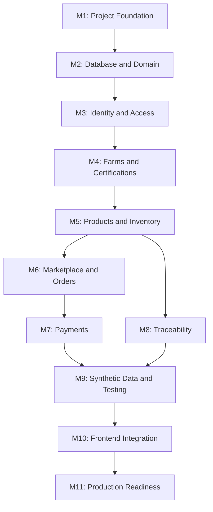

# Implementation Plan

**Project:** BioSouk  
**Document:** `docs/08-implementation-plan.md`  
**Version:** 1.0  
**Status:** Active

---

## 1. Purpose

This document defines the implementation strategy for BioSouk.

It establishes:

- Implementation milestones.
- Development sequence.
- Technical deliverables.
- Dependencies between components.
- Testing strategy.
- Acceptance criteria.
- Git workflow.
- Definition of completion.

Implementation MUST follow the approved architecture and engineering constitution.

## 2. Implementation Principles

1. Follow architecture-first development.
2. Implement incrementally.
3. Build working software at every milestone.
4. Prioritize domain correctness.
5. Write automated tests alongside implementation.
6. Maintain Clean Architecture boundaries.
7. Avoid premature microservice decomposition.
8. Keep application configuration externalized.
9. Use synthetic data for development and testing.
10. Document architectural decisions when significant trade-offs arise.

## 3. Implementation Strategy

BioSouk will be implemented as a modular monolith.

The initial architecture consists of:

- Backend API.
- Frontend application.
- PostgreSQL database.
- Synthetic data generator.
- External service integrations.

Backend modules MUST maintain clear ownership of their domain logic.

## 4. Implementation Milestones

### Milestone 1 — Project Foundation

**Objective:** Establish the development environment and repository structure.

Deliverables:

- Rust workspace.
- Backend application bootstrap.
- Frontend application bootstrap.
- Configuration management.
- Environment variables.
- Structured logging.
- Error handling foundation.
- Docker development environment.
- PostgreSQL connection.
- Health check endpoint.
- CI pipeline.

Acceptance criteria:

- Backend starts successfully.
- Frontend starts successfully.
- Database connection works.
- Health endpoint returns HTTP 200.
- CI executes formatting, linting, and initial tests.
- Secrets are not committed to Git.

### Milestone 2 — Database and Domain Foundation

**Objective:** Implement the core domain model and persistence infrastructure.

Deliverables:

- Database migrations.
- Identity entities.
- Farm entities.
- Product entities.
- Certification entities.
- Inventory entities.
- Order entities.
- Payment entities.
- Traceability entities.
- Repository interfaces.
- SQLx repository implementations.

Acceptance criteria:

- Migrations execute successfully.
- Database constraints are enforced.
- Domain invariants are tested.
- Repository integration tests pass.
- Database entities remain separate from domain models.

### Milestone 3 — Identity and Access Management

**Objective:** Implement authentication and authorization.

Deliverables:

- User registration.
- Login.
- JWT access tokens.
- Refresh token management.
- Logout.
- Password hashing.
- RBAC.
- Authorization middleware.
- User profile management.

Acceptance criteria:

- Users can register and authenticate.
- Invalid credentials are rejected.
- Expired tokens are rejected.
- Role-based permissions work.
- Resource ownership is enforced.
- Authentication tests pass.

### Milestone 4 — Farm and Certification Management

**Objective:** Implement agricultural business entities.

Deliverables:

- Farm registration.
- Farm profile management.
- Farmer association.
- Farm locations.
- Certification submission.
- Certification review.
- Certification expiration management.
- Administrative approval workflow.

Acceptance criteria:

- Farmers can manage authorized farms.
- Certifications can be submitted.
- Administrators can review certifications.
- Expired certifications cannot be treated as valid.
- Certification decisions are auditable.

### Milestone 5 — Product Catalog and Inventory

**Objective:** Implement marketplace product management.

Deliverables:

- Product categories.
- Product creation.
- Product updates.
- Product search.
- Product listings.
- Pricing.
- Inventory management.
- Batch management.
- Inventory movements.
- Availability calculation.

Acceptance criteria:

- Authorized sellers can manage products.
- Products are associated with valid farms.
- Prices are decimal-safe.
- Inventory quantities remain consistent.
- Unavailable products cannot be ordered.
- Product search and filtering work.

### Milestone 6 — Marketplace and Order Management

**Objective:** Implement the purchasing workflow.

Deliverables:

- Product discovery.
- Product details.
- Shopping cart.
- Order creation.
- Order items.
- Order pricing.
- Order status management.
- Order cancellation.
- Customer order history.

Acceptance criteria:

- Customers can create orders.
- Prices are calculated server-side.
- Inventory is validated.
- Concurrent purchases cannot oversell inventory.
- Duplicate order requests are handled safely.
- Order state transitions follow domain rules.

### Milestone 7 — Payment Integration

**Objective:** Implement secure payment processing.

Deliverables:

- Payment provider abstraction.
- Payment initiation.
- Payment confirmation.
- Webhook handling.
- Payment status tracking.
- Refund processing.
- Idempotency.
- Payment audit records.

Acceptance criteria:

- Payment requests are processed through a trusted provider.
- Webhooks are authenticated.
- Duplicate webhook events do not cause duplicate processing.
- Failed payments are handled safely.
- Refund operations are traceable.
- No sensitive payment credentials are stored in application logs.

### Milestone 8 — Product Traceability

**Objective:** Implement product and batch traceability.

Deliverables:

- Batch lifecycle.
- Production events.
- Harvest events.
- Quality inspection events.
- Packaging events.
- Distribution events.
- Delivery events.
- Traceability history API.
- Product journey representation.

Acceptance criteria:

- Traceability events reference valid batches.
- Events preserve chronological consistency.
- Historical records are auditable.
- Unverified information is clearly distinguished.
- Customers can access authorized traceability information.

### Milestone 9 — Synthetic Data and Testing

**Objective:** Establish realistic datasets and comprehensive test coverage.

Deliverables:

- Synthetic data generator.
- Dataset profiles.
- Seed-based reproducibility.
- Referential integrity validation.
- Business-rule validation.
- Demo dataset.
- Edge case dataset.
- Integration test fixtures.
- End-to-end test scenarios.

Acceptance criteria:

- Dataset generation is reproducible.
- Generated records respect domain constraints.
- Referential integrity passes.
- Edge cases are testable.
- Production databases cannot be targeted accidentally.
- Core business workflows pass end-to-end tests.

### Milestone 10 — Frontend Integration

**Objective:** Deliver the complete user-facing application.

Deliverables:

- Authentication screens.
- Customer dashboard.
- Farmer dashboard.
- Seller dashboard.
- Product catalog.
- Product details.
- Shopping cart.
- Checkout.
- Order history.
- Farm management.
- Certification management.
- Traceability interface.
- Administrative dashboard.

Acceptance criteria:

- Frontend integrates with documented APIs.
- Authentication and authorization are respected.
- Loading and error states are implemented.
- Forms validate user input.
- Core workflows work end-to-end.
- Responsive layouts are supported.

### Milestone 11 — Production Readiness

**Objective:** Prepare BioSouk for production deployment.

Deliverables:

- Docker production images.
- Deployment configuration.
- Secrets management.
- Database backup strategy.
- Database migration strategy.
- Structured logs.
- Metrics.
- Distributed tracing where appropriate.
- Health and readiness checks.
- Rate limiting.
- Security testing.
- Performance testing.
- Operational documentation.

Acceptance criteria:

- Production configuration is validated.
- Secrets are managed securely.
- Backups and recovery procedures are tested.
- Critical endpoints meet performance targets.
- Security tests pass.
- Monitoring and alerting are operational.
- Deployment and rollback procedures are documented.

---

## 5. Milestone Dependencies

Implementation MUST follow the logical dependencies below.



Some workstreams MAY proceed in parallel when their interfaces and dependencies are stable.

For example:

- Frontend wireframes can begin during backend foundation work.
- Synthetic data generator design can begin during database implementation.
- Traceability can progress independently of payment integration after the relevant domain interfaces exist.

## 6. Development Workflow

Each implementation task MUST follow this sequence:

1. Understand the business requirement.
2. Identify affected domain boundaries.
3. Define the application use case.
4. Define or update API contracts.
5. Implement domain behavior.
6. Implement persistence.
7. Implement API handlers.
8. Write automated tests.
9. Update documentation.
10. Review architecture compliance.
11. Commit changes.

Avoid implementing business logic directly in HTTP handlers or frontend components.

## 7. Testing Strategy

Testing MUST occur at multiple levels.

| Test Type | Responsibility |
|---|---|
| Unit | Domain rules and application logic |
| Integration | Database and repository behavior |
| API | HTTP contracts and authorization |
| End-to-end | Complete business workflows |
| Security | Authentication and access control |
| Performance | Throughput and latency |
| Reliability | Retries, failures and concurrency |

Critical workflows MUST have automated regression tests.

## 8. Git and Branching Strategy

Recommended branches:

- `main` — stable and production-ready.
- `develop` — integration branch, if a multi-branch workflow is needed.
- `feature/*` — new functionality.
- `fix/*` — bug fixes.
- `docs/*` — documentation changes.

Commit messages SHOULD follow Conventional Commits.

Examples:

```bash
git commit -m "feat(biosouk): initialize Rust backend workspace"
git commit -m "feat(biosouk): implement authentication module"
git commit -m "feat(biosouk): add farm management workflows"
git commit -m "test(biosouk): add inventory integration tests"
git commit -m "docs(biosouk): update implementation plan"
```

## 9. Definition of Done

A milestone is complete only when:

- [ ] Required functionality is implemented.
- [ ] Domain rules are enforced.
- [ ] Automated tests pass.
- [ ] Security requirements are satisfied.
- [ ] API documentation is updated.
- [ ] Relevant architectural decisions are documented.
- [ ] Code passes formatting and linting.
- [ ] No unresolved critical defects remain.
- [ ] Changes are committed to Git.

## 10. Project Completion Criteria

BioSouk's initial production release is considered complete when:

1. Customers can discover products and place orders.
2. Farmers can manage their farms and products.
3. Certifications can be submitted and verified.
4. Inventory is managed consistently.
5. Payments and refunds are processed securely.
6. Product traceability is available.
7. Administrative workflows are operational.
8. Frontend and backend integration is complete.
9. Automated quality checks pass.
10. Deployment, monitoring, backup, and recovery procedures are operational.

---

**End of Document**
